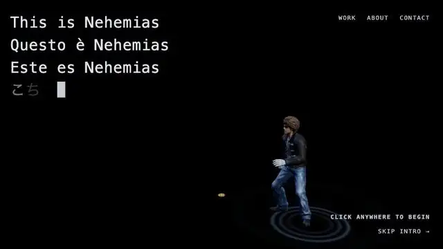
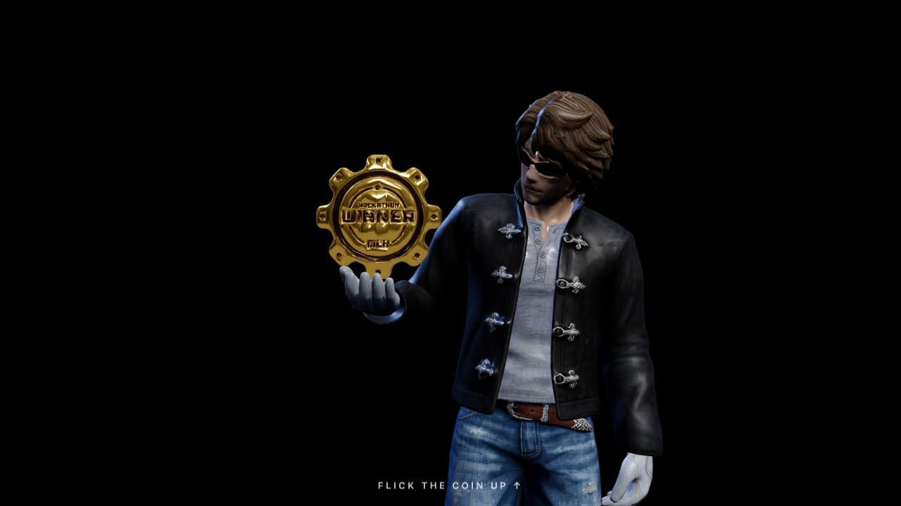
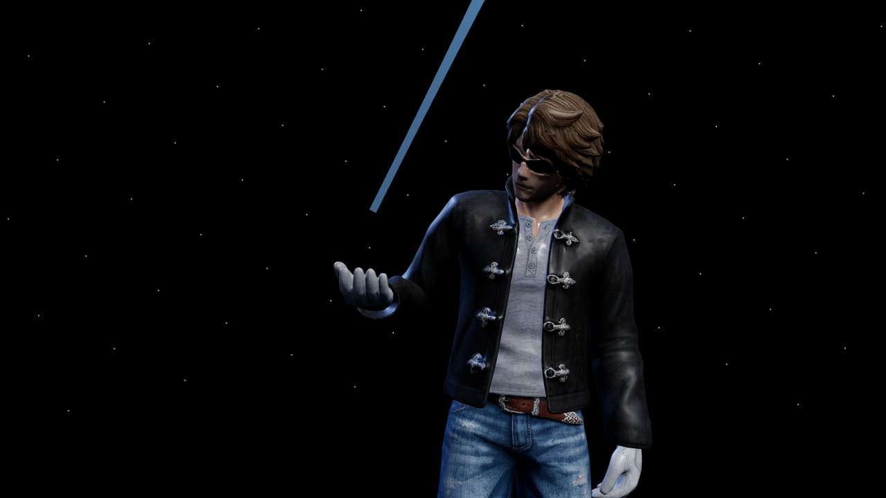
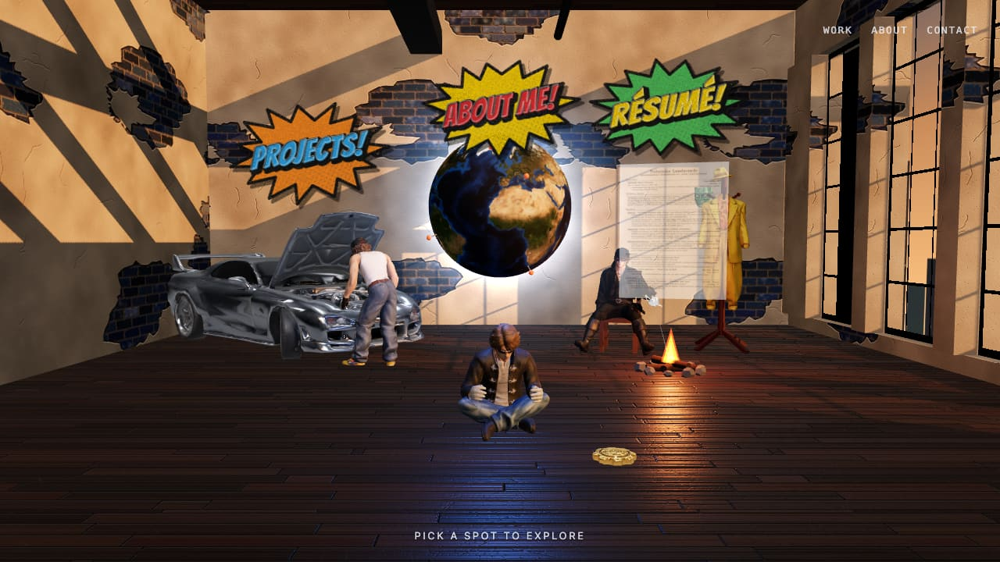
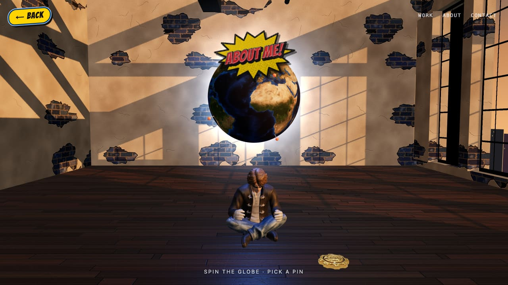
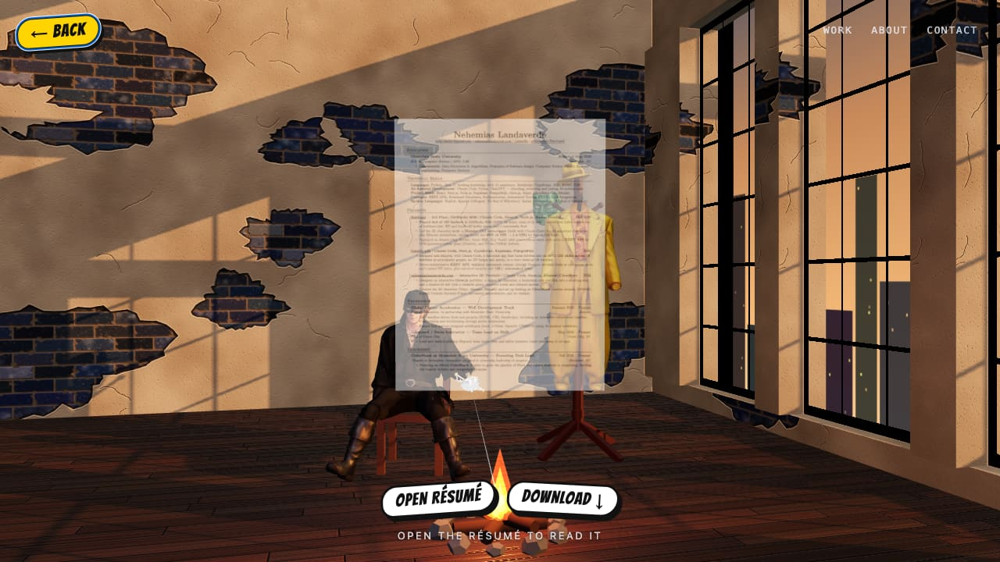
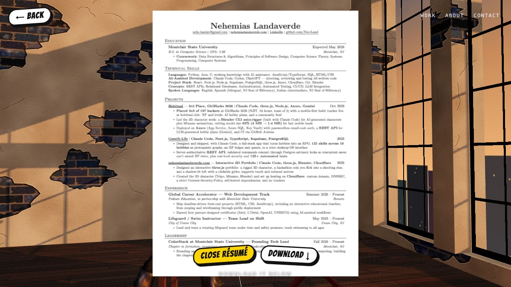

# Nehemias Landaverde — Interactive 3D Portfolio

**Live: [nehemiaslandaverde.com](https://nehemiaslandaverde.com)** · works on desktop and phones



A portfolio you walk into instead of scroll through. My 3D avatar, Neo, paces a dark void; click anywhere and he
picks up his hackathon coin. Flick it upward and it streaks off like a shooting star, splitting the screen open into
a sunlit loft where each part of the portfolio is a place in the room: a globe of places I've been, a garage for
projects, and a campfire where my résumé floats, ready to read or download.

Built from scratch with **three.js** (no framework, no build step), with the character made in **Tripo**, rigged in
**Mixamo** and animated in **Blender**. Hosted on **Cloudflare** as a static site with a strict security policy.

| | |
|---|---|
|  |  |
|  |  |
|  |  |

## Highlights

- **A custom, rigged character.** Neo started as reference art, became a mesh in Tripo (image-to-3D), was
  auto-rigged in Mixamo, and got custom animation keyed by hand in Blender (the coin pickup and palm-up turn).
  Outfit variants (mechanic, swordsman) reuse his skeleton and skin weights.
- **Fast despite the 3D.** Models went from 11.5 MB to about 4.3 MB: smooth decimation (Neo 97k → 30k triangles),
  WebP textures and meshopt compression via glTF-Transform. The loft downloads while you watch the intro, and the
  screen holds on white until its shaders are compiled, so it fades in without a flash. The scene only renders at
  full rate while something moves (30 fps when idle, nothing at all behind the portfolio panel).
- **Textures drawn in code.** The brick, worn plaster, floorboards, skyline and comic-book signs are painted on
  `<canvas>` at runtime: zero bytes to download, and the plaster wears away differently on every visit.
- **Real interactions.** A flick gesture for the coin, raycast hotspots for each corner of the room, camera flights
  between them, a drag-to-spin globe with clickable pins, and a résumé you can open in-scene or download.
- **Locked down.** Static hosting only (no server, database or forms), every dependency self-hosted and
  version-pinned, a strict Content-Security-Policy (no inline scripts; the import map is allowed by hash), HSTS,
  DNSSEC, a domain that refuses to send email (SPF `-all`, DMARC reject), a firewall rule against secret-file
  probes, and a `security.txt`.
- **Accessible.** Touch, mouse and keyboard; honours `prefers-reduced-motion`; the portfolio panel is a native
  `<dialog>`; the résumé is a real PDF as well as a 3D page.

## How it was built

I designed the experience, made the 3D assets (Tripo, Mixamo, Blender), set up the hosting, and directed, reviewed
and tested every change. The web code was written with **Claude Code**, an AI coding assistant, working from my
direction. Every visual decision went through rounds of rendered screenshots on desktop and phone sizes before it
shipped.

The full story, including the dead ends (a PS2-style low-poly look, a painted landscape through an archway, a
hologram résumé) and the reasons they were cut, is in the build log: **[PROGRESS.md](PROGRESS.md)**.

## Tech

| | |
|---|---|
| **3D / rendering** | three.js 0.170 (self-hosted), WebGL, custom canvas textures, meshopt-compressed glTF |
| **Character & assets** | Tripo (image-to-3D), Mixamo (rigging, base animations), Blender (keyframing, decimation, export) |
| **Asset pipeline** | glTF-Transform CLI (resample, WebP, meshopt), sharp (images, icons, previews) |
| **Code** | Vanilla JavaScript modules, HTML, CSS (about 1,250 lines of scene and interaction code) |
| **Hosting** | Cloudflare Workers static assets, auto-deployed from `main`; custom domain with DNSSEC |
| **Built with** | Claude Code |

## Run it locally

Any static server works (the page loads `.glb` models, so `file://` won't):

```bash
python3 -m http.server 8000 --directory public
```

Then open <http://localhost:8000/>.

## Project structure

| Path | What it is |
|---|---|
| `public/` | **The deployed site: only this folder is published** |
| `public/index.html`, `style.css`, `app.js` | Markup, styles, and all scene and interaction code |
| `public/*.glb` | Neo, his outfit variants, the car, the coin and props (meshopt + WebP) |
| `public/vendor/` | Self-hosted three.js, meshopt decoder, Earth textures, font (licences in `LICENSES.txt`) |
| `public/_headers`, `_redirects` | Security headers and redirects, applied by Cloudflare |
| `wrangler.jsonc` | Cloudflare config: serve `public/` as static assets (no server code) |
| `PROGRESS.md` | The build log: decisions, dead ends and gotchas |
| `docs/` | Screenshots for this README |

## Lessons learned

- **Mixamo can't rig a mesh that comes with roughness/metallic textures** ("unable to map your existing skeleton").
  Upload the bare mesh and reattach materials afterwards.
- **Download Mixamo animations *With Skin*.** Without it, clips rest in a T-pose while the rig rests in an A-pose,
  so every arm rotation lands about 56° off.
- **Footstep ripples** fire from the walk clip's measured foot-plant times; the slow walk barely lifts its feet, so
  height-based detection missed steps.
- **Blender 5 actions are layered** (`action.layers → strips → channelbags → fcurves`), and the glTF exporter freezes
  bones whose rotation mode isn't quaternion.
- **Quantised glTF stores scale in the node transform**, so never overwrite a loaded node's position or scale; wrap
  it in a `THREE.Group` and move that.
- **Prefetched textures must not assume the scene exists yet.** The résumé image once finished downloading during
  the intro, before the loft was built, and silently failed to attach. It's now applied when the loft is created.

## Model compression

Every `public/*.glb` is compressed with [glTF-Transform](https://gltf-transform.dev) (a dev-time CLI, never
served). The site decodes them with the self-hosted meshopt decoder, which is why the CSP allows
`'wasm-unsafe-eval'`. After re-exporting a model from Blender:

```bash
npx @gltf-transform/cli@4 resample in.glb a.glb      # animated models only
npx @gltf-transform/cli@4 webp a.glb b.glb --quality 86
npx @gltf-transform/cli@4 meshopt b.glb public/out.glb --level medium
```

## What's next

- **Projects corner:** the garage becomes a walk-through of Hobitual and Gamify.Life.
- **A new landing scene** (Neo on a rooftop) is in progress on a separate branch.

## License

© Nehemias Landaverde. The code is public so it can be read and reviewed; all rights reserved. Third-party files
in `public/vendor/` keep their own licences (see `LICENSES.txt`).
