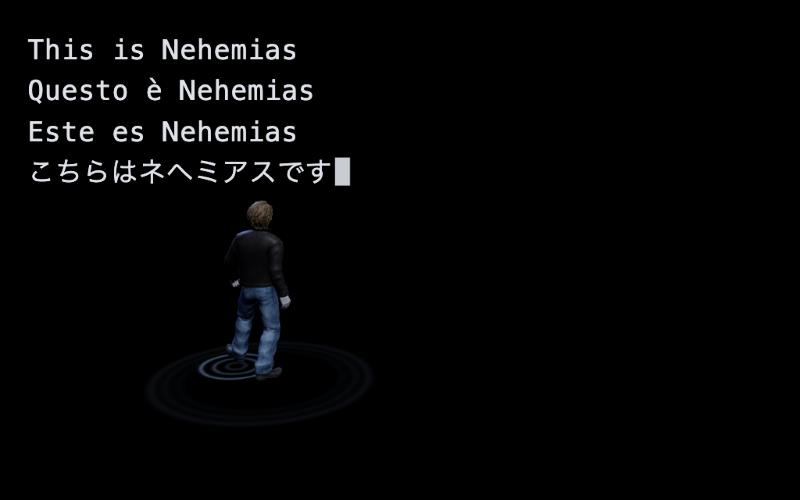
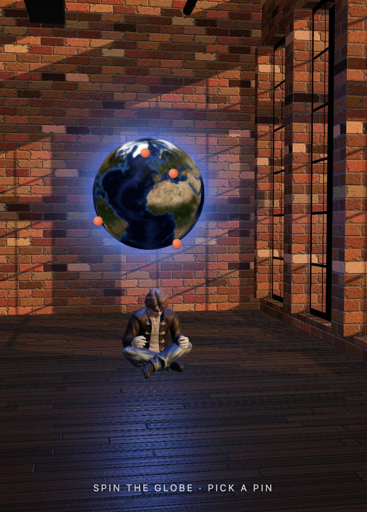

# Nehemias — Personal Website

An interactive 3D portfolio. A rigged character ("Neo") walks an oval in a black void, every footstep rippling the floor. Tap him and the camera pushes in while a boarding pass slides out of his pocket onto his seam; pull to tear the ticket and the seam splits open into light, revealing a moody brick loft where he sits beneath a glowing, pinned globe of places.

Built with **three.js**, **Blender**, **Mixamo**, **Tripo** (AI image-to-3D) and **globe.gl** — one static HTML file plus one `.glb`.

| Opening | Ticket | Tear + reveal | Loft |
|---|---|---|---|
|  |  |  |  |

## The experience

1. **Void** — black screen; Neo walks a long left↔right ellipse at a constant ground speed. Each foot plant drops a water-like ripple.
2. **Greeting** — top left, typed on load: *Welcome, friend…* in English, Italian, Spanish and Japanese, then *This is Nehemias*.
3. **One tap** — Neo turns to camera and idles; the camera slowly pushes in to his seam while a boarding pass (EWR → ANY) slides out of his right pocket and settles with its perforation exactly on the seam.
4. **Tear** — drag/swipe in any direction: the ticket tears top-down along the perforation as a white slit opens down the seam. Let go past 60 % and it blooms into white (let go early and it springs back).
5. **Loft** — warm, moody brick loft: dark glossy hardwood, tall steel windows with a golden-hour skyline, real window shadows. Neo sits cross-legged under a floating globe with a pulsing blue aura; its pins poke out of the surface — tap one to zoom in and read its card.
6. **Portfolio layer** — always-available *Work · About · Contact* panel, plus *Skip intro →* for visitors in a hurry.

Works on phones (tap / swipe, narrower framing), respects `prefers-reduced-motion`, and the panel is a native `<dialog>` (focus trap, Esc to close).

## Run locally

Any static server works (the page fetches `neo.glb`, so `file://` won't):

```bash
python3 -m http.server 8000
```

Then open <http://localhost:8000/neo.html>.

## Edit your content

Everything recruiters read lives in the `SITE` object near the top of the module script in [`neo.html`](neo.html): name, role, bio, skills, projects (`title`, `blurb`, `tags`, `live`, `code`, `image`), email, LinkedIn, GitHub and résumé. Empty links are hidden. Places on the globe are the `PLACES` list; the greeting is `GREETINGS`.

## Project structure

| Path | What it is |
|---|---|
| `neo.html` | The whole site: three.js scenes, ticket, tear, loft, globe, portfolio panel |
| `neo.glb` | Neo — 48.7k-face textured mesh, 41-bone Mixamo rig, animations `neo_slow_walk`, `neo_idle`, `neo_sit` |
| `neo_rawv2/` | Tripo export the character was built from (FBX + PBR textures) |
| `neo_rigged.fbx` | Mixamo auto-rig of that mesh |
| `neo_slow_walk.fbx`, `neo_idle.fbx`, `neo_sit.fbx` | Mixamo animations (downloaded **With Skin**) |
| `neo_front.png`, `neo_side.png`, `neo_back.png`, `neofrontv2.jpeg` | Character reference images (`neofrontv2` = upscaled front used for generation) |
| `index.html` | Earlier 2D version of the jeans/ticket/globe idea (kept for reference) |
| `PROGRESS.md` | Detailed development log, decisions and gotchas |
| `docs/` | Screenshots |

## Asset pipeline

1. **Reference** — front/side/back turnaround of the character; front view upscaled to 848×1264.
2. **Image → 3D** — Tripo H3.1, *Quad* topology, 50k polycount, 4K PBR, *Remove Lighting* on.
3. **Rig** — mesh exported from Blender as a plain OBJ (no materials) → Mixamo auto-rigger (Standard skeleton).
4. **Animate** — Mixamo clips downloaded **With Skin**, actions extracted in Blender and attached to the rig; forward drift removed from the hips so walks play in place.
5. **Export** — Blender → `neo.glb` (mesh + textures + skin + 3 actions). Blender is driven from Claude Code through the official Blender MCP connector.

### Lessons learned (the non-obvious bits)

- **Mixamo "unable to map your existing skeleton"** on a mesh with no skeleton → caused by roughness/metallic textures. Upload the mesh only; reattach materials afterwards.
- **Mixamo animations must be downloaded *With Skin*.** *Without Skin* files rest in a T-pose while the rig rests in the uploaded A-pose, so every arm rotation lands ~56° off (arms cross the body).
- **Mixamo returned the rig at 1/100 scale** (OBJ metres read as centimetres) — rescale the armature in Blender.
- **glTF bones load in an animation pose**, not the rest pose — so the ticket is anchored to real skinned-mesh vertices (pocket, top/bottom of the seam), not to the hips bone.
- **Footstep ripples** fire from the clip's measured foot-plant times; the slow walk barely lifts the feet, so height-based detection missed steps.
- **Blender 5 actions are layered** (`action.layers → strips → channelbags → fcurves`); the glTF exporter freezes bones whose rotation mode was switched away from quaternion.

## Large files (not in the repo)

GitHub warns above 50 MB and Git LFS isn't set up, so these stay local:

- `neo.blend` (75 MB) — the working Blender scene (rig, actions, retarget bakes). Rebuildable from the FBX files above following [`PROGRESS.md`](PROGRESS.md).
- `neo_raw/` (61 MB) — first, 2M-face Tripo export (superseded by `neo_rawv2/`).

To version them later: `brew install git-lfs && git lfs install && git lfs track "*.blend"`.

## Roadmap

- [ ] Fill in `SITE` (bio, projects, links, résumé) and `PLACES`
- [ ] Rename `neo.html` → `index.html`, deploy as a static site, point the domain
- [ ] Add `og:url` / `og:image` (1200×630 screenshot) for link previews
- [ ] Optional: Draco-compress `neo.glb` for faster first load
